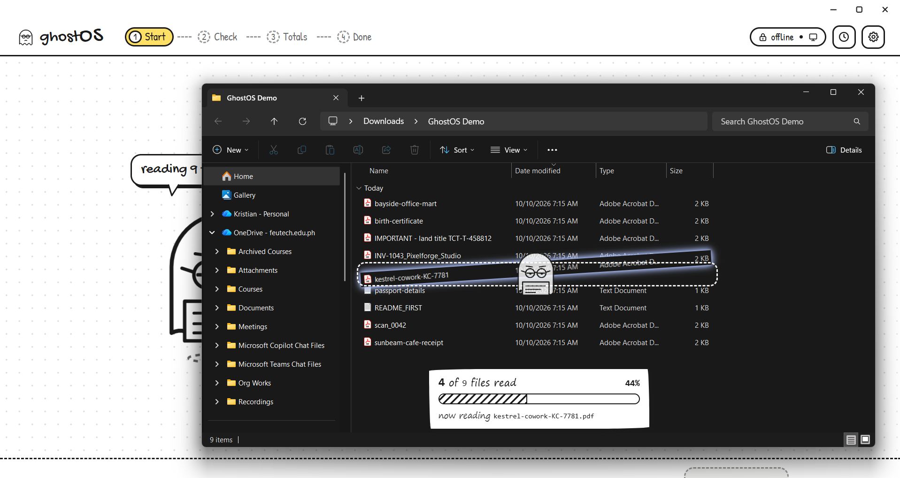
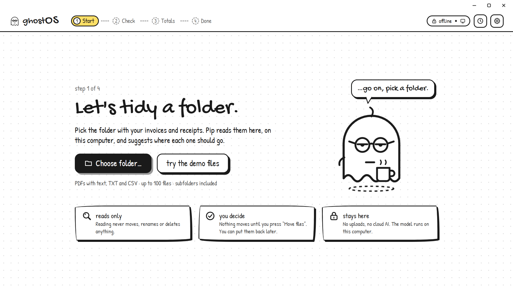
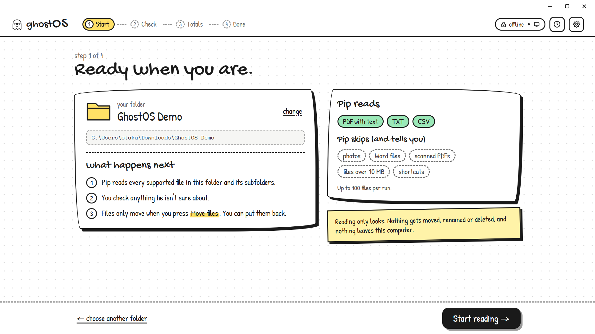
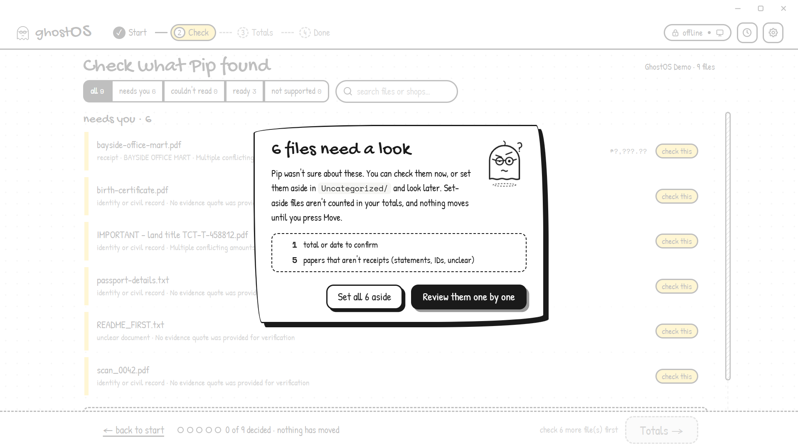
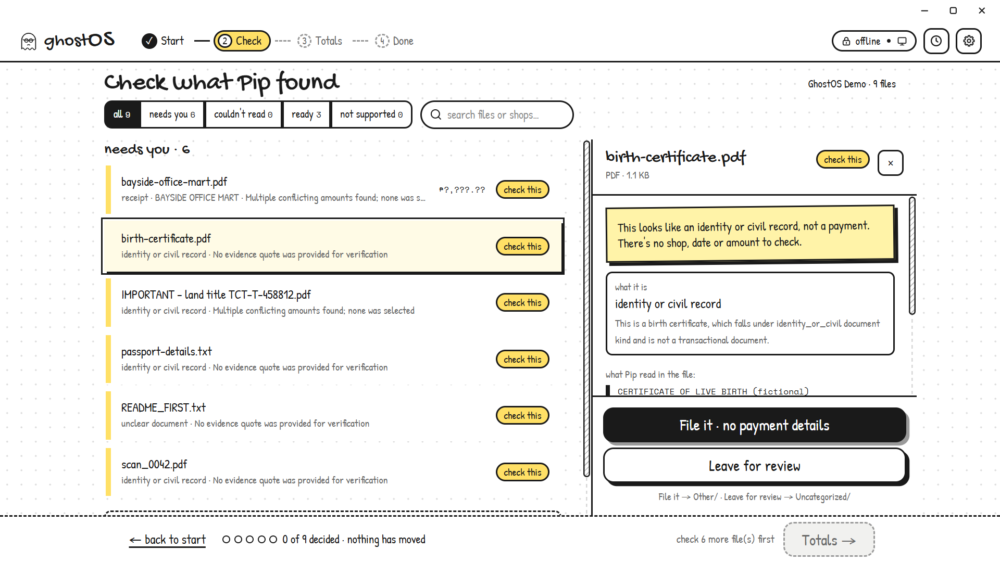

# GhostOS

**Your paperwork never leaves your laptop, and nothing moves without your say-so.**

GhostOS is a desktop workspace that organizes messy folders of receipts, invoices, and notes into tidy dated folders — and drafts your expense report along the way. A small AI model running **entirely on your own computer** reads each file, tells you what it found, and flags anything it's unsure about. You review, you approve, and only then does anything move. Changed your mind? One click puts everything back.

Built for the **AppBuildersPH Hackathon 2026**.

## Screenshots

<!--
  Screenshot guide: drop your images into an `assets/screenshots/` folder
  (create it if needed) and reference them below. Recommended width 800px.
  The section renders as a side-by-side grid on wide screens.

  To fill in a slot, replace the placeholder path after the `src=` with your
  file, e.g. `src="assets/screenshots/01-pick-folder.png"`, and replace the
  "TODO" caption with a one-line description of what the shot shows.
  Delete any `<figure>` block you don't use, or leave it commented out.

  Example of a filled slot:
  <figure>
    
    <figcaption>1 · Pick a folder</figcaption>
  </figure>
-->

<div align="center">
  
  <p><em>The GhostOS landing page — pick a folder and let a local model sort your paperwork, offline.</em></p>
</div>

|  |  |
|---|---|
| <figure><figcaption>Ready when you are — confirm to start</figcaption></figure> | <figure><figcaption>Pick a folder</figcaption></figure> |
| <figure><figcaption>Files that need a look — review one by one or set aside</figcaption></figure> | <figure><figcaption>TODO: check what Pip found</figcaption></figure> |
| <figure><figcaption>TODO: preview destinations and totals</figcaption></figure> | <figure><figcaption>TODO: approve and move</figcaption></figure> |
| <figure><figcaption>TODO: done — and undo</figcaption></figure> |  |

## Why it exists

Freelancers, small businesses, and anyone drowning in PDFs share one miserable chore: turning a pile of receipts into organized records and expense totals. Cloud tools can do it — by uploading your financial life to someone else's server. GhostOS does it **offline, on-device**, so bank statements, IDs, and medical papers are never sent anywhere.

## How it works

1. **Pick a folder** — a messy mix of PDFs, text files, and CSVs (up to 100 files).
2. **GhostOS reads everything locally.** An on-device model (Ollama) classifies each file — receipt, invoice, statement, ID, or "not sure" — and pulls out shop, date, amount, and currency, with the exact quote it read them from.
3. **It's honest about doubt.** Conflicting totals, missing dates, unreadable scans, and even sneaky text inside files trying to give it orders get *flagged for you* instead of guessed. A birth certificate is never forced into an expense row.
4. **You check its work.** Confirm, fix, or set aside each flagged file. Set-aside files are never counted and never move early.
5. **You preview the plan.** Exact destination for every file (`Receipts/2026-09/`, …) plus expense totals — before anything happens.
6. **You approve.** One "Move" press reorganizes the folders and writes the expense CSV.
7. **You can undo.** Everything goes back to where it was.

## Safety design (the part we're proud of)

- **Local-first:** inference at `127.0.0.1:11434`, backend at `127.0.0.1:8000`, zero external requests. Works with Wi-Fi off.
- **The model never decides anything destructive:** destinations come from a fixed backend map, never from model output; money is handled as exact decimals, never floats.
- **Evidence or it didn't happen:** every extracted amount must appear verbatim in the source text; conflicting or unsupported amounts are rejected, never counted.
- **No silent failures:** symlinks, oversized, and unreadable files are skipped with reasons; collisions get numeric suffixes, never overwrites; every move is recorded in an undo manifest.

The model is never allowed to choose destination paths, filesystem operations, or editable-field lists. Those decisions are owned by backend code. `needs_review` is a review state, not a folder name: `Uncategorized/` is the backend destination for unresolved or unclassified documents, while intentionally filed non-transactional documents may use `Other/`.

Filesystem checks are repeated immediately before each move. Source and destination paths must remain inside the selected root; symlink components, traversal, changed SHA-256 identities, and occupied destinations block the operation. Plan snapshots, report publication, and undo state are recoverable in-process, but the current session store is in memory and does not survive a backend restart. The filesystem workflow is not fully transactional.

## Run it

You need **Python 3.11+**, **Node.js 20.19+**, and (for real inference) **Ollama** with the model pre-pulled.

```powershell
# 1. Local AI (one-time)
ollama list
ollama pull qwen3:4b-instruct
ollama serve

# 2. Backend (from backend/)
py -3 -m venv .venv
.\.venv\Scripts\Activate.ps1
python -m pip install -r requirements.txt
python -m uvicorn app.main:app --host 127.0.0.1 --port 8000 --reload

# 3. Frontend (from frontend/)
npm install
npm run dev:browser        # http://127.0.0.1:5173
```

By default the UI runs on **built-in demo data** (look for the demo badge) so you can click through the whole flow with no setup. To use the live backend, create `frontend/.env.local`:

```
VITE_USE_FIXTURES=false
VITE_API_BASE=http://127.0.0.1:8000
```

A 20-file sample folder with edge cases (duplicates, collisions, conflicts, statements, prompt injection) lives in `tests/fixtures/sample_folder/`.

If `ollama list` already shows `qwen3:4b-instruct`, do not pull it again. If Ollama is already running, leave it running and skip `ollama serve`.

## Local URLs and API

- Frontend: <http://127.0.0.1:5173>
- Backend API: <http://127.0.0.1:8000>
- Interactive API docs: <http://127.0.0.1:8000/docs>
- Backend status: <http://127.0.0.1:8000/api/status>
- Contract examples: <http://127.0.0.1:8000/api/contracts/examples>
- Ollama: <http://127.0.0.1:11434>

The backend CORS configuration allows `http://127.0.0.1:5173` and `http://localhost:5173` without credentials.

## Backend architecture

| Path | Responsibility |
|---|---|
| `backend/app/schemas.py` | Pydantic API contracts, classification fields, document kinds/profiles, plans, and approval models |
| `backend/app/services/local_ai.py` | Local Ollama `qwen3:4b-instruct` adapter and strict structured classification response |
| `backend/app/services/document_awareness.py` | Backend derivation of `document_kind` and `field_profile` |
| `backend/app/services/classification_validation.py` | Exact evidence checks, Decimal amount reconciliation, currency normalization, and review flags |
| `backend/app/services/scanner.py` | Safe folder enumeration and metadata for PDF, TXT, and CSV inputs |
| `backend/app/services/extractor.py` | PDF/text/CSV extraction, bounded excerpts, and SHA-256 computation |
| `backend/app/services/orchestrator.py` | Scan workflow, validation integration, destination planning, report-row selection, and immutable snapshots |
| `backend/app/services/session_store.py` | In-memory scan, plan snapshot, and batch state |
| `backend/app/services/report.py` | Decimal-based expense CSV rendering and temporary/atomic publication helpers |
| `backend/app/services/path_safety.py` | Root containment, Windows path equivalence, and source-directory collision checks |
| `backend/app/routes/session.py` | Scan sessions, corrections, plan preview/approval, commit, progress, and undo |
| `backend/app/routes/classify.py` | Direct classification endpoint for supplied local-file requests |
| `backend/app/routes/contracts.py` | Development contract examples; no scanning, Ollama calls, or file writes |

## Document-aware classification

GhostOS keeps these concepts separate:

- `category` is the backend-controlled organization decision: `invoice`, `receipt`, `other`, or `uncertain`.
- `document_kind` describes the paper: `receipt`, `invoice`, `statement`, `identity_or_civil`, `legal`, `medical`, `other`, or `uncertain`.
- `field_profile` is derived by backend code: `transaction`, `reference`, or `none`.

Receipts and invoices normally use the `transaction` profile; statements use `reference`; identity/civil, legal, medical, other, and uncertain documents use `none`. Transaction corrections are limited to transaction-profile records, and non-transactional records do not enter expense totals by default.

A genuinely old record that omitted both document-aware fields may use the documented category fallback. A current record carrying `document_kind: null` is conservative and derives `field_profile: "none"`. These states must remain distinct through scanning, storage, corrections, planning, and reporting. Clients cannot provide `field_profile`, arbitrary editable-field lists, destination paths, or operations.

Evidence quotes must match source text. Missing fields, unsupported or conflicting currencies, and ambiguous amounts remain review findings. A parseable `amount_text` is not automatically trusted; accepted expense rows require a source-supported canonical amount and no unresolved review flags.

## Organization, approval, and undo

Plan previews are immutable snapshots containing the selected mode, destination decisions, and source identity data. Approval commits that snapshot instead of rebuilding a plan. Session changes make a plan stale and approval returns HTTP 409, requiring a new preview and explicit approval.

The default `blocking` mode rejects approval while unresolved blocking review items remain. Explicit `partial` mode bypasses only that review-count gate; it does not bypass malformed-operation checks, path containment, symlink checks, SHA-256 identity checks, collisions, no-overwrite behavior, report recovery, or undo checks.

Backend-owned destination policy is:

- reviewed transactions use the safe category/date destination;
- intentionally filed non-transactional documents may use `Other/` and remain out of expense rows;
- unclassified, unreadable, unresolved, or explicitly Leave-for-Review documents use `Uncategorized/` and remain reviewable.

Leave for Review is a filing choice, not classification acceptance. Batch state records successful, failed, and pending operations; report publication can be retried after a failure, and undo verifies file identity and the free original path before restoring it. This is not a fully transactional filesystem workflow, and in-memory recovery state does not survive a backend restart.

## Expense CSV and amount trust

Reports include only accepted transaction records with a trusted canonical amount, supported currency, and no unresolved review flags. Raw `amount_text` is never used to recover an amount rejected by source-aware validation. Unresolved, `filed_uncounted`, non-transactional, duplicate, and ambiguous records are excluded from expense rows and currency totals.

The validator supports `PHP`, `USD`, `EUR`, `GBP`, `SGD`, and `JPY`, using explicit codes or supported unambiguous symbols where available. Monetary handling uses `Decimal`, never float.

## Verify it

```powershell
# Backend (from backend/, venv activated)
python -m pytest -q       # full suite
python -m pytest -q tests/test_schemas.py tests/test_classification_validation.py tests/test_validation_integration.py tests/test_session.py

# Frontend (from frontend/)
npm run typecheck
npm run lint
npm test
npm run build
```

The sample-folder evaluator uses real local Ollama inference and writes results under `backend/evaluation_output/`; keep baseline and experiment outputs separate. Verify `ollama list` first and do not treat fixture data as model output.

## Current status and open work

Implemented in the current backend are local scanning/extraction, structured local classification, source-aware validation, document-aware profiles, immutable blocking/partial plans, `Uncategorized/` and `Other/` routing, safe commit/undo, recoverable report publication, and the `filed_uncounted` outcome for transactions with no amount. Rerun the suites before quoting a current test count.

| Area | Status |
|---|---|
| DA-5b | Open QA follow-up: decide how a new model response that omits `document_kind` should be persisted versus the documented legacy fallback. |
| DA-2 | Open classification review for ambiguous aircon payment-note semantics. |
| DA-4 | Open team decision on utility-bill semantics. |
| DA-7/UI1 | Backend trust-boundary and `filed_uncounted` paths have regression coverage; fresh browser acceptance for empty-amount correction and final report flow is still required. |
| D1 | Cross-scan document IDs remain a separate integration issue. |
| Browser/offline | Browser visual flows, Wi-Fi-off inference acceptance, and restart/recovery acceptance need fresh end-to-end evidence. |
| Symlink QA | Windows symlink tests may be skipped when the account lacks symlink privilege (`WinError 1314`); repeat them where symlink creation is permitted. |
| Contract alignment | Keep fixture/mock and live-backend response types aligned as document-aware fields continue to be integrated. |

## Project layout

| Path | What |
|---|---|
| `backend/app/` | FastAPI service: scanning, extraction, local-AI classification, validation, plan preview, approval, undo |
| `backend/tests/` | Contract, validation, and session tests |
| `frontend/src/` | React + TypeScript UI (browser + Electron): Check → Totals → Done flow, paper design system |
| `frontend/src/api/` | `GhostApi` interface, HTTP client, and the fixture mock used for demos |
| `tests/fixtures/sample_folder/` | 20-file demo dataset covering the edge cases |
| `tests/reports/` | QA evidence: acceptance logs, retest reports, model evaluations |
| `docs/` | Product plan, API handoff, design screens, QA strategy |
| `context.md` | Working reference: mission, phases, and team ownership |

## Team

| Developer | Ownership |
|---|---|
| John Janiel Obmerga | Backend foundation, API contracts, scanning, safe paths, commit/undo |
| Kurt Laurence Tendero | Ollama/local model, classification, validation, offline verification |
| Kristian David Bautista | Frontend/desktop UI, evidence and approval experience, pitch and submission |
| Jhon Vincent Libatique | Test dataset, fixtures, QA, integration, demo support |
